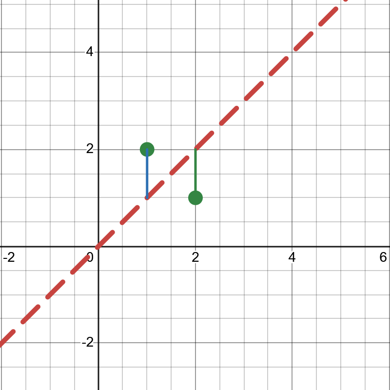

# Some R Datasets to Play With

R comes with a few dataset delivered with the base installation.

```{r}
summary(mtcars)
```

More on `mtcars`:

```{r}
head(mtcars)
```

```{r}
str(mtcars)
```

Another interesting dataset is `iris`:

```{r}
summary(iris)
```

```{r}
head(iris)
```

```{r}
str(iris)
```

> **Disclaimer** These datasets are useful as toy datasets for testing simple models or for educational purposes! They should not be used for other "serious" purposes!


# Playing with `mtcars`

*For what each columns is, see [https://www.rdocumentation.org/packages/datasets/versions/3.6.2/topics/mtcars](https://www.rdocumentation.org/packages/datasets/versions/3.6.2/topics/mtcars).*

First, we load a summary of the data:

```{r}
summary(mtcars)
```
In order to visually look for variables that might affect, e.g., `mpg`, we can use the following:

```{r}
# `pairs` plots pairs of variables we ask for in scatter plots.
pairs(mpg ~ ., data = mtcars)
```

Since we suspect a negative linear dependence between `mpg` and `wt` (fuel consumption and vehicle weight), we plot this one scatterplot separately:

```{r}
plot(mtcars$wt, mtcars$mpg)
```

From this plot we might formulate a naive hypothesis:

> Heavier vehicles tend to have a less `mpg` value, i.e., tend to consume more fuel per mile.

# Notes on Linear Regression

If we use the formula:

$$SE=\sum_{i=1}^n\varepsilon_i$$

for quantifying errors, we might end up with a situation like the following:

